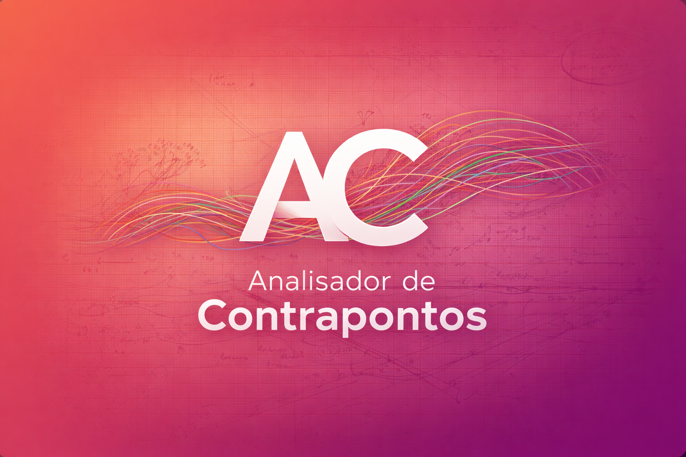

# Analisador de Contrapontos

Plugin para o **MuseScore Studio 4** que auxilia na correção de exercícios de
contraponto. Ele analisa a partitura, compara o que encontrou com as regras
configuradas pelo usuário e mostra uma lista de aspectos a revisar,
marcando as notas envolvidas.

**Versão atual:** 0.5.3 (beta) · [Histórico de versões](CHANGELOG.md) · Licença [GPL-3.0](LICENSE)

## O que o plugin verifica

- **Tipos de exercício:** cantus firmus, 1ª a 5ª espécies e contraponto livre,
  em contextos modais e tonais, a 2 ou mais vozes.
- **Condução de vozes:** paralelas, ocultas e intermitentes; uníssonos;
  cruzamento e distância entre as vozes; equilíbrio entre movimentos
  contrários, oblíquos e similares; primeiro e último intervalos.
- **Melodia:** âmbito, saltos (tamanho, compensação e saltos consecutivos),
  intervalos aumentados e diminutos, trítono, arpejos, ponto focal, notas
  inicial e final, alterações (música ficta, 6º e 7º graus).
- **Tratamento de dissonâncias:** nota de passagem, bordadura (simples e
  dupla), cambiata, suspensão (inclusive com resolução interrompida),
  apojatura, escapada, antecipação e nota pedal, levando em conta tempos
  fortes, meio-fortes e fracos.
- **Coerência harmônica:** compara as notas com as cifras de análise por
  números romanos escritas na partitura.
- **Resultado:** lista filtrável por categoria (Condução de Vozes, Melodia,
  Dissonâncias e Outros Aspectos), com dicas sobre cada aspecto e relatório
  com sugestão de nota para o professor.

Todas as verificações podem ser ligadas, desligadas e ajustadas. As
configurações podem ser salvas em arquivos `.cfA` e reaproveitadas; a última
configuração usada é guardada automaticamente (arquivo `analisador_auto.cfA`,
na pasta do plugin).

## Instalação

1. Baixe o plugin: clique em **Code ▸ Download ZIP** nesta página (ou baixe
   uma versão específica na aba **Tags**).
2. Descompacte e copie a pasta **`Analisador`** inteira (com o `Analisador.qml`
   e o `Logo.png`) para a pasta de plugins do MuseScore:
   - **Windows:** `Documentos\MuseScore4\Plugins\`
   - **macOS:** `~/Documents/MuseScore4/Plugins/`
   - **Linux:** `~/Documentos/MuseScore4/Plugins/` (ou `~/Documents/MuseScore4/Plugins/`)

   A pasta exata pode ser conferida em **Editar ▸ Preferências ▸ Pastas ▸ Plugins**.
3. No MuseScore, abra **Plugins ▸ Gerenciar plugins**, encontre
   **Analisador de Contrapontos** e clique em **Ativar**.
4. O plugin passa a aparecer em **Plugins ▸ Contraponto ▸ Analisador**.

## Como usar

1. Escreva o exercício na partitura (cada voz em uma pauta).
2. Opcionalmente, selecione o trecho ou as pautas a analisar. Sem seleção,
   a partitura inteira é analisada.
3. Abra o plugin, escolha o tipo de exercício (cantus firmus, espécie ou
   contraponto livre) e ajuste as verificações desejadas.
4. Clique em **Verificar**. As ocorrências aparecem na lista de resultados;
   clique em um item para marcar as notas na partitura (duplo clique mostra
   uma dica). Ao fechar a lista, as notas voltam à cor original, e o botão
   **Ver análise** reabre a última lista.

O [manual da versão 0.3](docs/manual-v0.3.md) (MuseScore 2 e 3) continua
disponível e descreve em detalhe os conceitos e as opções de configuração,
embora a interface atual seja diferente.

## Versões anteriores

- **MuseScore 3:** use a tag [`v0.4.6`](../../tree/v0.4.6).
- **MuseScore 2:** use a tag [`v0.4.1-ms2`](../../tree/v0.4.1-ms2)
  (arquivo `musescore2/Contraponto.qml`).

## Autor

Rogério Tavares Constante. Desenvolvido no âmbito do projeto
*Harmonia e Contraponto*.

Sugestões e relatos de problemas são bem-vindos na aba **Issues**.
